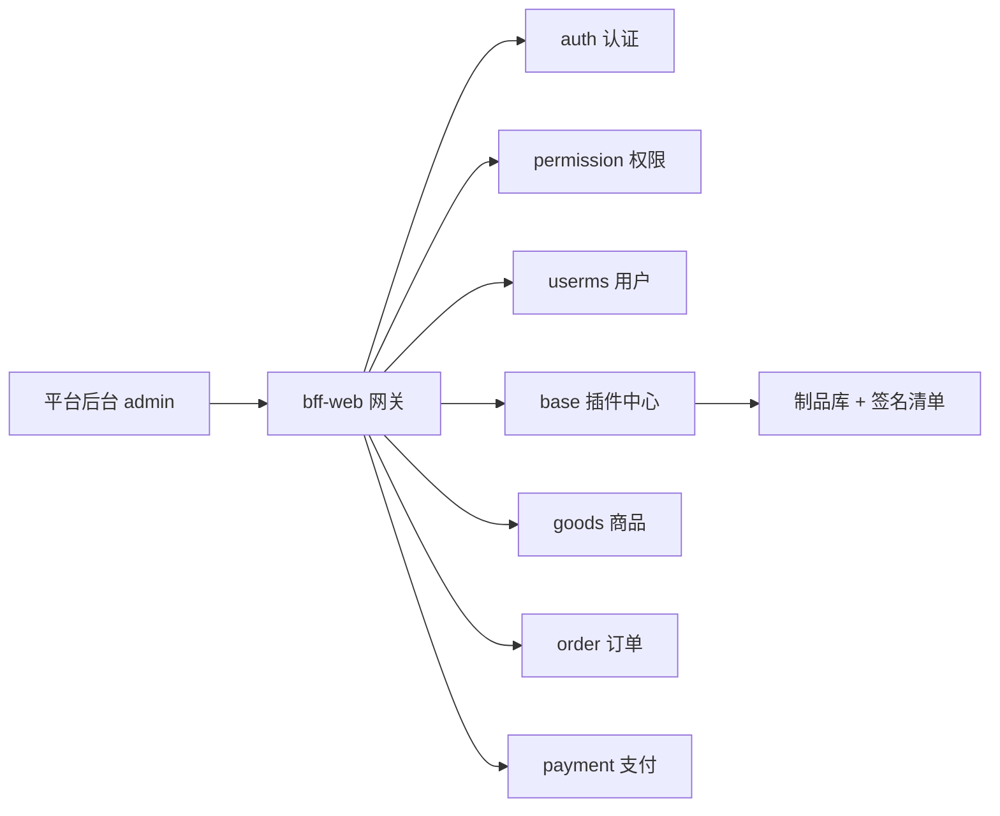

# UniMall · 开源多商户电商中台（Core）

> 品牌与商标：本项目对外统一使用 **UniMall** 名称；使用名称与 Logo 的边界以仓库内 `NOTICE` 为准。

微服务架构 + 插件化扩展的**多商户电商中台**：一套后端同时支撑平台后台、商户后台、PC 商城、统一 App 等多端业务；插件按需装载，业务服务独立运行、独立发布。

## 核心能力

- **微服务内核**：Spring Boot 3 + Spring Cloud Alibaba、JDK 21、Nacos 注册与配置中心、MySQL 8 + Redis + RocketMQ + Seata，多模块 Maven 工程
- **插件化扩展**：插件中心（目录/授权/市场/制品/发布审核/升级）+ `custom-<service>` 源码二开位，行业能力以嵌入式插件或独立服务两种形态交付
- **多商户**：一套部署支撑多商户经营，商户端与平台端权限/数据隔离
- **多端前端**：Vue 3 + Vite——平台后台 `frontend/admin`、商户后台 `frontend/bcenter`、PC 商城 `frontend/pc`、统一 App `frontend/uniapp`
- **全链路签名交付**：插件制品 Ed25519 签名 + SHA-256 校验，安装侧默认验签（fail-closed）

## 架构



- 每个业务服务独立进程、独立库表，经 BFF（`/web` 前缀）对外；`architecture/services.json` 是服务与插件归属的唯一清单
- 插件两种形态：**嵌入式（embedded）**装载进宿主服务进程（PF4J），**独立服务（standalone）**以 Docker 镜像交付、由安装代理启动
- 插件管理控制面集中在 `backend/paas/base/modules/`（plugin-center / plugin-market / plugin-license / plugin-artifact / plugin-publish / plugin-registry / plugin-update）

## 快速开始（两种安装方式任选）

**方式一 · 界面化安装向导（推荐新用户）**：克隆代码后一条命令起向导，浏览器点选即可完成安装——
支持「Docker 默认安装」（自动创建预定义的中间件与数据库容器）与「自定义安装」（填写你自己的
数据库/Redis/Nacos 地址、端口、账号密码，测试连通后部署）；安装完成页展示各服务访问信息。

```bash
bash deploy/install.sh --wizard     # 然后浏览器打开 http://<本机IP>:<WEB_PORT>/ 自动进入向导
```

**方式二 · 命令行一键装机**：

```bash
bash deploy/install.sh              # 中间件 + 5 个核心服务（登录/权限/用户/插件中心/网关）
bash deploy/install.sh --with-admin # 再加平台后台前端
```

两种方式产物一致（同一份编排、同一套种子）；安装状态持久化在 `data/install-state.json`，
已安装后向导会拒绝重复安装。细节见 [public/docs/docker/操作手册.md](public/docs/docker/操作手册.md)。

首次执行约 10–20 分钟（含 Maven 构建）。装机后的逐项验收清单见 [deploy/README.md](deploy/README.md)。

**安装完成后怎么登录后台**：访问 `http://<本机IP>:<WEB_PORT>/`，内置两个管理员账号：

| 账号 | 用户名 / 手机号 | 角色 | 初始密码 |
|---|---|---|---|
| 超级管理员 | `admin` / `13800000000` | 平台超管（`is_admin=1`，权限集为通配 `["*"]`，**有意不绑 RBAC 角色**） | `Admin@123456` |
| 演示管理员 | `demo` / `13900000001` | 绑定「管理员」RBAC 角色（菜单按角色授权返回） | `Admin@123456` |

两个账号同源于种子脚本（`deploy/scripts/sql/init/99-seed.sql`、`105-tenant-seed.sql`），密码散列相同。

> 🔴 **首登后请立即改密**。开源基线默认关闭了后台登录图形验证码（`houcloud.auth.captcha.enabled=false`，
> 见 Nacos `auth.yaml`）：基线不含验证码生成组件，开启等于装完即无法登录；生产部署请接入滑块/
> 图形验证组件后再改回 `true`。

> ℹ️ 后台登录接口为 `POST /web/auth/login`，请求体需带 `platForm: "2"`（后台端标识）；
> 不带该参数会走买家/商家分支，报「店铺已关闭，请联系平台」（33033）。超级管理员因无
> RBAC 角色，菜单接口 `/web/permission/user/menus` 返回空数组属**预期行为**（权限中心按
> 角色授权出菜单，超管走通配权限不挂菜单树）；需要验证菜单数据请用演示管理员 `demo`。

最小集验证（登录后）：

```bash
# 插件中心路由与鉴权（未登录返回 401/403 属正常）
curl -s http://127.0.0.1:8391/web/plugin/plugin-center/list | head -c 300
```

## 插件全链路（创建 → 上架 → 购买 → 下载 → 安装）

`deploy/verify-plugin-chain.sh` 以一个真实 PF4J 插件（`plugins/goods/hello-world`）走完 12 步验收：

```
登录 → 站点身份 → 创建插件 → 上传制品 → 提交审核 → 审核上架
→ 市场详情 → 下单（协议确认）→ 支付 → 授权 → 换票下载（SHA-256 校验）
→ 安装（平台预检 + 宿主装载 + 插件接口双路由验证）
```

关键语义：

- **跨宿主 fail-closed**：`hostService: goods` 的插件只能由 goods 宿主进程装载；在 base 的插件中心对其调安装会得到错误码 `3020`（宿主不匹配），而不是静默装错进程
- **嵌入式插件装载路径**：制品投放宿主 `plugins/` 目录 + 宿主开启 `houcloud.plugin.boot-enabled: true`，由插件引擎启动扫描装载（路由注册 + 扩展点注册）
- **独立服务安装**：由 `plugin-platform/installer/` 安装代理执行——下载校验签名、`docker image load`、候选容器健康检查通过后切换正式容器，失败自动回滚
- 插件示例的三处真实实现：`plugins/goods/hello-world`（后端 PF4J 插件）、`backend/extensions/custom-goods`（服务二开位）、`frontend/admin/src/extensions/base/hello-world`（前端扩展页）

## 目录结构

```
backend/
  bff/                     聚合网关 bff-web（对外唯一 HTTP 入口 8391）
  paas/<service>/          独立业务服务（auth / permission / userms / base / goods / order / payment / merchant / job / thirdparty / tool）
  paas/base/modules/       插件管理控制面（目录、授权、市场、制品、发布审核、升级）
  contracts/               服务间公开契约（plugin-api 等）
  extensions/custom-<svc>/ 服务专属二开位（官方源码不直接改业务服务）
plugin-platform/
  sdk/                     插件开发 SDK（清单模型、签名）
  runtime/                 插件引擎（PF4J 装载、路由扫描、宿主装配）
  release/                 Ed25519 签名与密钥工具
  registry/  installer/    插件注册表 / 独立服务安装代理（Java 独立可执行）
plugins/<host>/<code>/     插件源码（示例：plugins/goods/hello-world）
frontend/                  admin（平台后台）bcenter（商户后台）pc（商城）uniapp（App）
deploy/                    部署一切：install.sh 一键装机、verify-plugin-chain.sh 全链路验收、Dockerfile×N 镜像材料、mysql-init 种子、nacos-templates 配置模板、scripts/ 部署与架构闸门脚本
architecture/services.json 服务与插件归属唯一清单
```

## 开源范围与许可证

- **Core 仓库**：本仓库全部内容以 [Apache-2.0](LICENSE) 发布（见 [NOTICE](NOTICE)），含完整的插件中心、插件市场与安装代理源码
- **商业插件**：PAID / TRIAL 产品（ERP、OA、CRM、GEO 等）的源码与运行制品**不在本仓库**，不影响 Core 的编译与运行
- **贡献**：见 [CONTRIBUTING.md](CONTRIBUTING.md)（含 DCO 签署要求 [DCO.txt](DCO.txt)）与 [CODE_OF_CONDUCT.md](CODE_OF_CONDUCT.md)
- **安全披露**：见 [SECURITY.md](SECURITY.md)，请勿在公开 Issue 提交漏洞细节

## 文档导航

| 文档 | 内容 |
|---|---|
| [deploy/README.md](deploy/README.md) | 装机形态、端口、逐项验收、插件全链路验收 |
| [public/docs/docker/操作手册.md](public/docs/docker/操作手册.md) | Docker 编排全貌：模式 A/B、编排文件清单、四层启动验证、故障排查 |
| [backend/paas/base/modules/README.md](backend/paas/base/modules/README.md) | 插件管理控制面模块结构 |
| [plugin-platform/installer/README.md](plugin-platform/installer/README.md) | 独立服务安装代理：签名校验、镜像导入、回滚语义 |
| [CONTRIBUTING.md](CONTRIBUTING.md) | 贡献流程与代码约定 |
